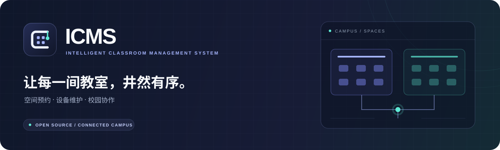
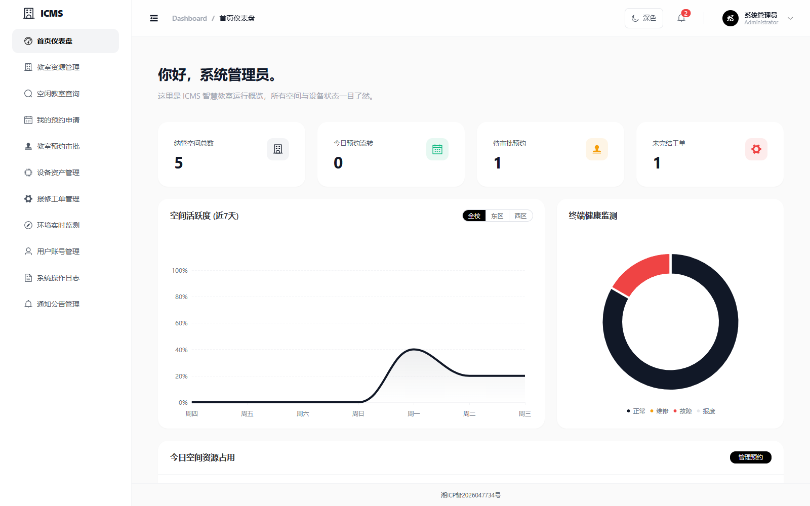
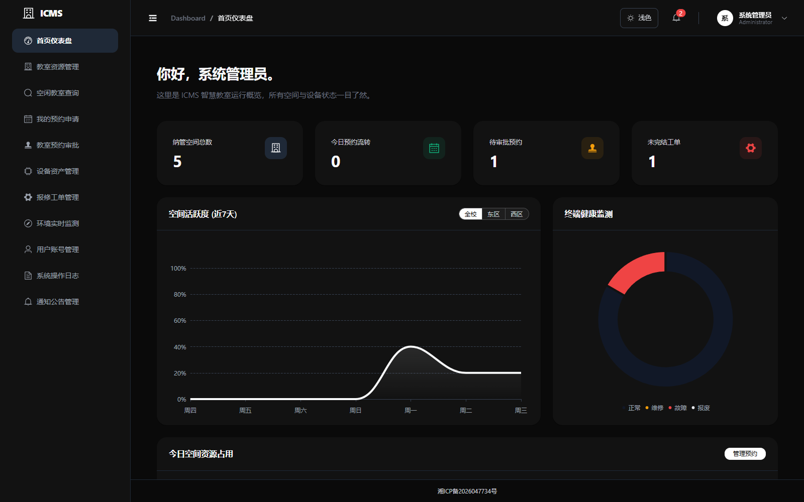
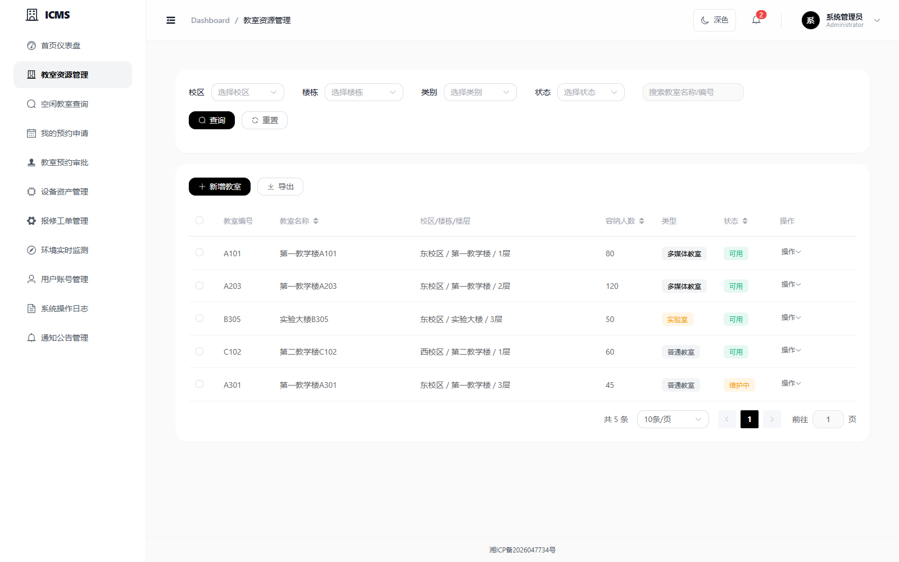
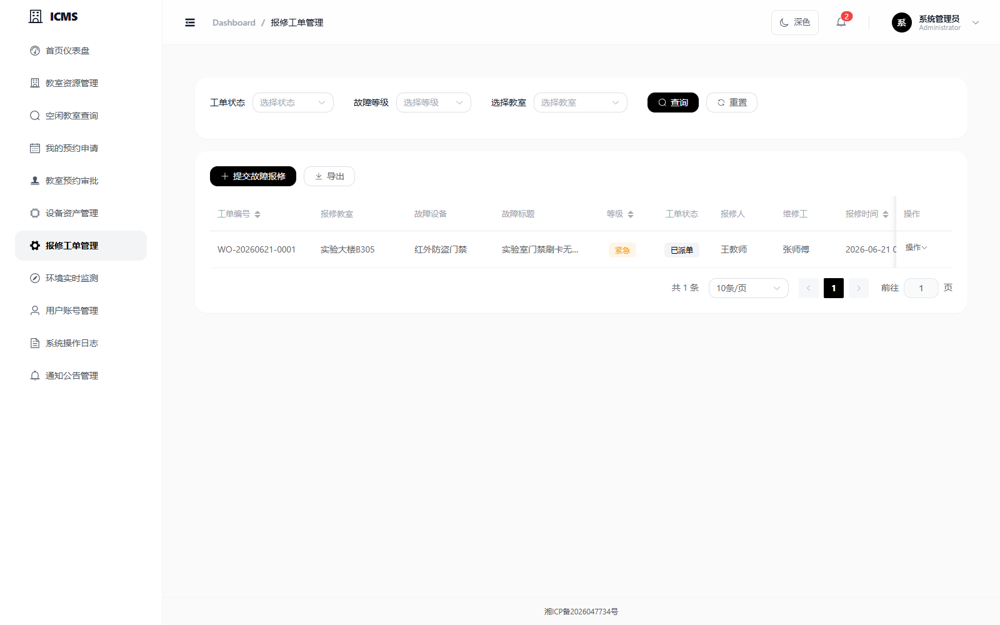
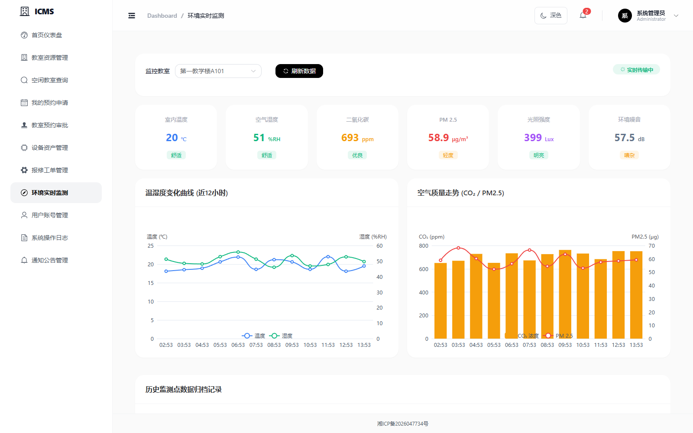
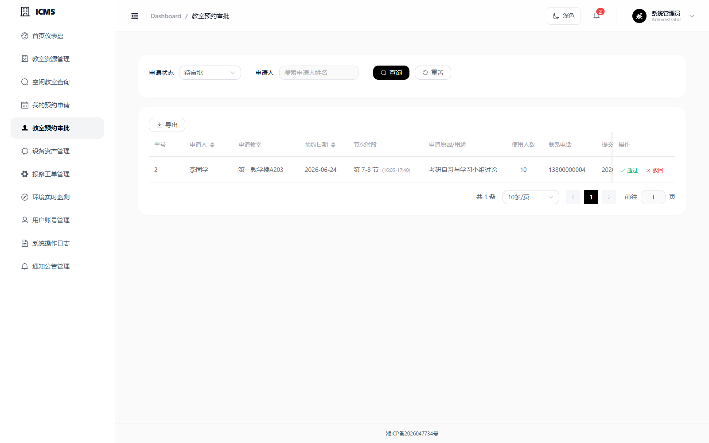

<div align="center">



<p><strong>从一间教室的预约，到整个校园的资源协作。</strong></p>
<p>基于 Vue 3 与 Spring Boot 3，连接教室、课表、设备和工单。</p>

<p>
  
  
  
  <a href="LICENSE"></a>
  <a href="https://github.com/Sa3ura/icms/actions/workflows/ci.yml"></a>
</p>

<p>
  <a href="https://icms.unjust.cn/">在线体验</a> ·
  <a href="#界面预览">界面预览</a> ·
  <a href="#快速开始">快速开始</a> ·
  <a href="docs/DEVELOPMENT.md">开发指南</a> ·
  <a href="docs/DEPLOYMENT.md">部署指南</a>
</p>

</div>

---

## 界面预览

以下为本地 Mock 模式的真实页面截图，使用演示数据；环境监测尚未接入真实传感器。点击图片可查看原图。

**工作台 · 校园资源一览**

[](docs/assets/screenshots/dashboard-light.png)

<details>
<summary><strong>切换视角：查看深色主题</strong></summary>

[](docs/assets/screenshots/dashboard-dark.png)

浅色 / 深色一键切换，自动记住上次选择。

</details>

| 教室资源 · 多条件筛选 | 报修工单 · 状态追踪 |
| :---: | :---: |
| [](docs/assets/screenshots/classrooms.png) | [](docs/assets/screenshots/workorders.png) |
| **环境监测 · 指标与趋势** | **预约审批 · 协同安排** |
| [](docs/assets/screenshots/environment.png) | [](docs/assets/screenshots/reservations.png) |

## 一套系统，连接使用与维护

面向管理员、教务、教师、学生和维修人员，连接教室资源的查询、使用与维护流程。

| 模块 | 主要能力 |
| :--- | :--- |
| 教室与课表 | 管理校区、楼栋和教室，按日期、节次、容量与设备查询空闲教室 |
| 预约与审批 | 提交预约、检查时间冲突、审批与取消申请 |
| 设备与工单 | 维护设备档案，完成报修、指派、处理与关闭，并联动设备状态 |
| 统计与监测 | 查看空间使用情况、设备状态及环境趋势；环境监测目前使用模拟数据 |
| 系统管理 | 用户与角色管理、通知公告、操作日志 |

按角色呈现可用菜单与操作，支持浅色 / 深色主题及主题记忆。可独立运行 Mock 演示，也可连接真实后端。

## 快速开始

先体验界面和业务流程，无需启动后端或数据库。

准备 Node.js 22.12+（22.x）或 24.x，在仓库根目录执行：

```bash
cd ICMS-frontend
npm ci
npm run dev:e2e
```

打开 **<http://localhost:5173>**。此命令启用 Mock 模式，数据保存在浏览器本地；演示账号见 [开发指南](docs/DEVELOPMENT.md#本地演示账号)。

完整开发环境见 [开发指南](docs/DEVELOPMENT.md)；上传服务器前请参考 [部署指南](docs/DEPLOYMENT.md)。

## 技术栈

| 层级 | 技术 |
| :--- | :--- |
| 前端 | Vue 3 · Vite · Element Plus · Pinia · ECharts |
| 后端 | Java 17 · Spring Boot 3 · MyBatis-Plus · Sa-Token |
| 数据与工程 | MySQL 8 · Flyway · Vitest · JUnit · Playwright · GitHub Actions |

## 文档导航

| 文档 | 内容 |
| :--- | :--- |
| [开发指南](docs/DEVELOPMENT.md) | 项目结构、完整启动、本地账号与常用命令 |
| [部署指南](docs/DEPLOYMENT.md) | 构建产物、外部配置、OpenResty / Nginx 代理与常见问题 |
| [测试说明](docs/TEST_CASES.md) | 自动化测试范围、CI 流程与业务用例 |
| [需求设计](ICMS_需求设计文档.md) | 业务背景与需求设计 |
| [数据库设计](ICMS_数据库表设计.md) | 数据表与字段说明 |

---

<div align="center">

<p>Logo 以「C 形教室轮廓、四个座位与连接节点」表达空间与协作。<br />
<a href="docs/assets/brand/logo.svg">SVG 标志</a> · <a href="docs/assets/brand/logo.png">PNG 标志</a> · <a href="docs/assets/README.md">视觉素材说明</a></p>
<p>本项目采用 <a href="LICENSE">GNU AGPL v3</a> 开源许可证。</p>

</div>
